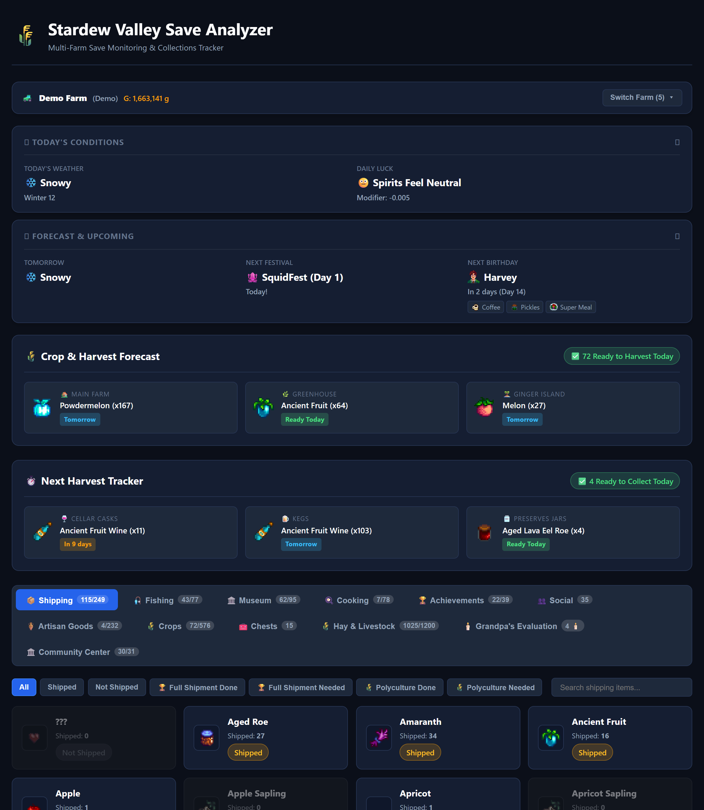
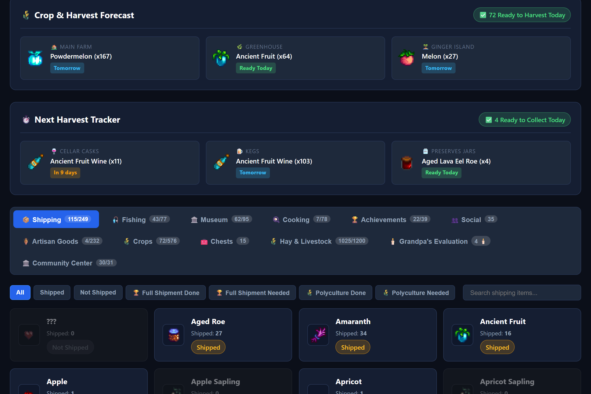
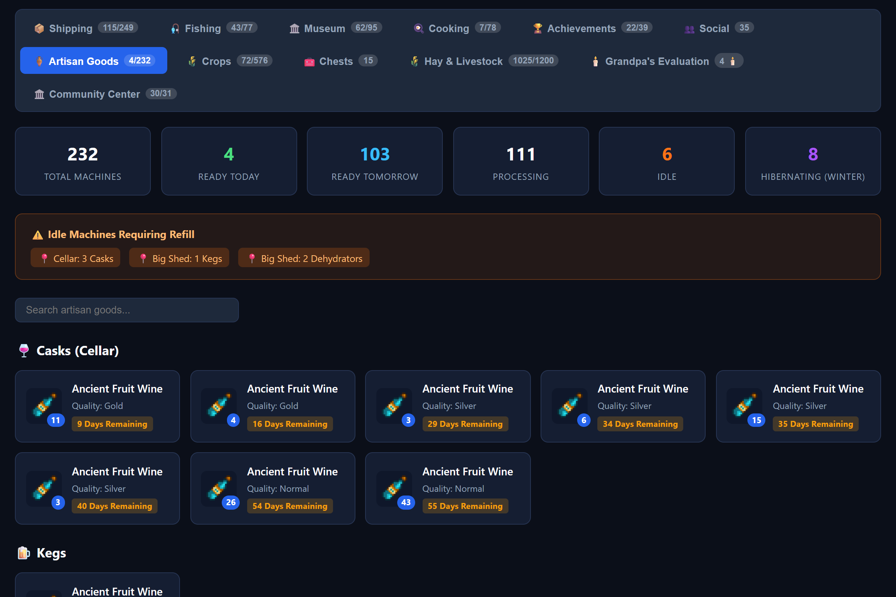
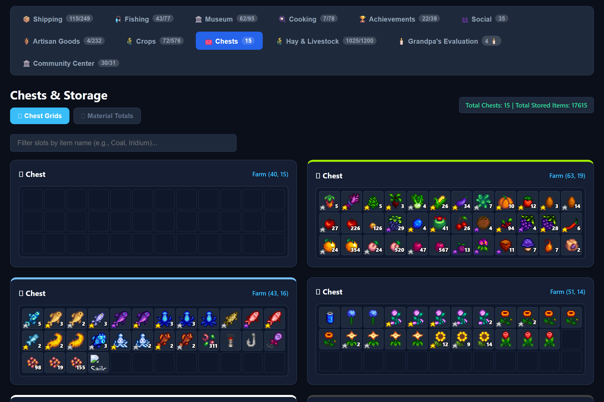
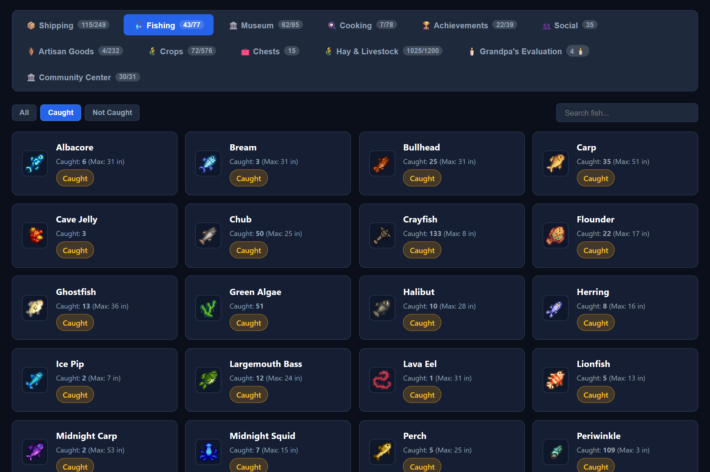
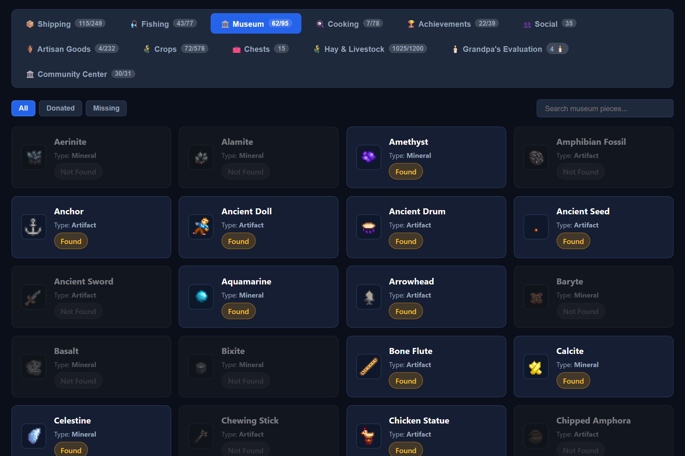
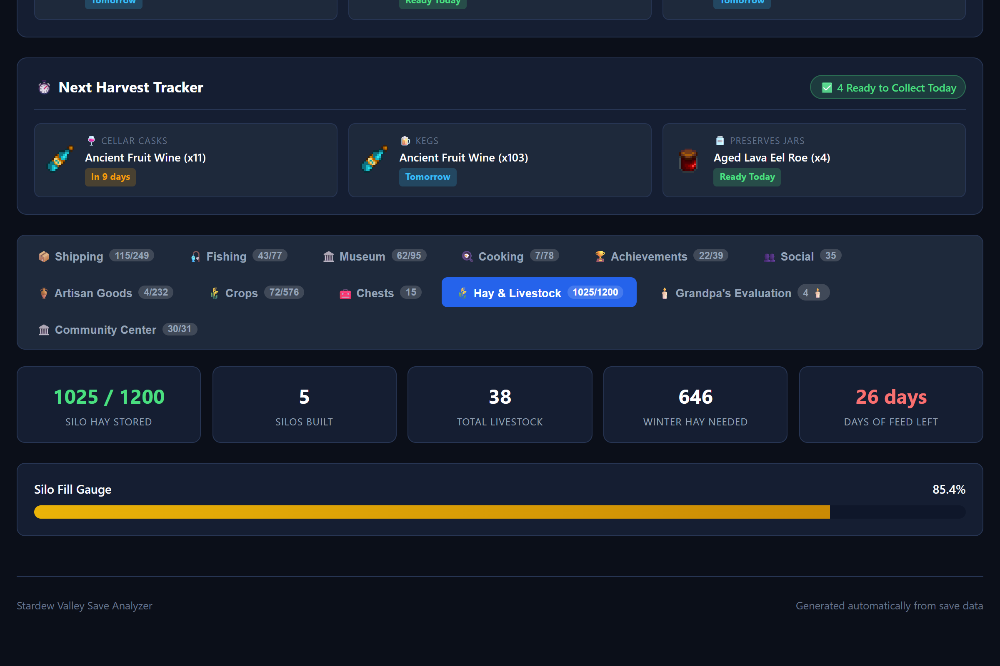
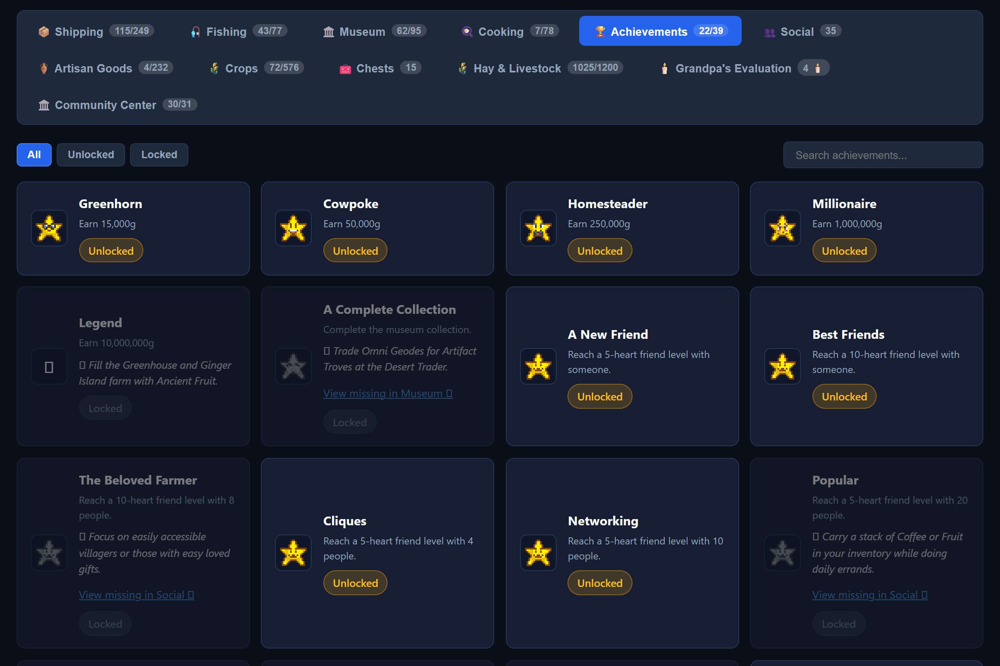
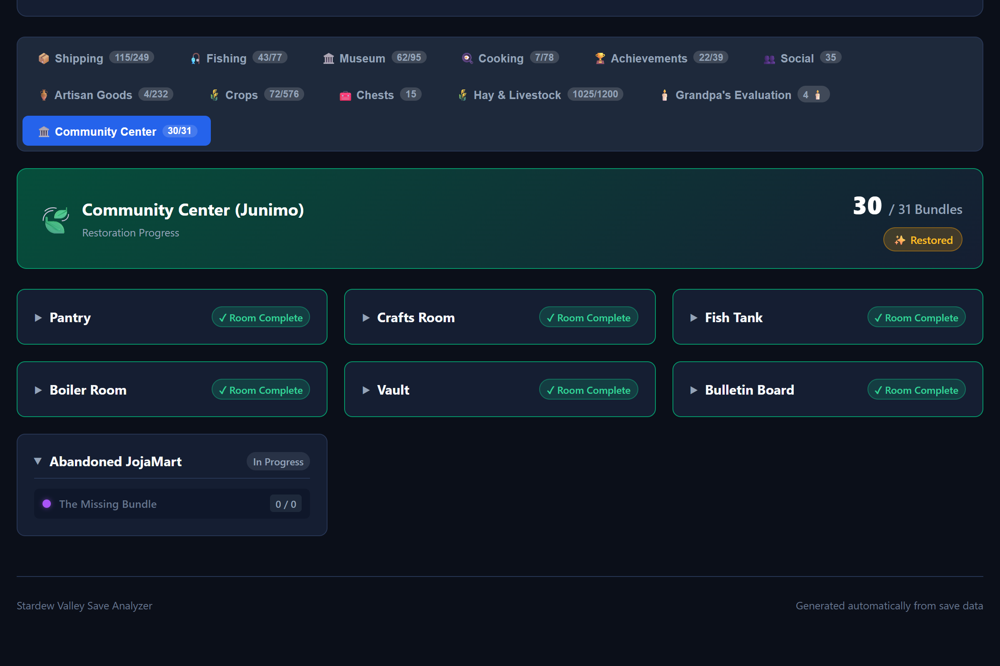

# 🌾 Stardew Valley Save Analyzer


<p align="center">
  
</p>


A lightweight, local-first web dashboard designed specifically for self-hosted homelabs and single-host setups. It parses raw Stardew Valley save XML files and renders a dynamic, responsive dashboard for tracking farm progress, collections, and relationships across multiple saves — without relying on external cloud processing.

---
## v2.0.0 Update notice - Important ##

<details>
<summary>
Click here for details!
</summary>

To ensure compliance with copyright policies, it was necessary to remove all Stardew Valley images from the repository.
But fear not, there is a solution! I integrated an extractor to get all the images into the Stardew Analyser. All you have to do, is mount the Content folder of your legally owned copy of Stardew Valley into the container and at container start all the relevant images are extracted.

More information can be found in the compose script comments.

And if your playing on console and can't mount the content folder, there is a fallback mechanism, so you can still use the analyser, but without images.
</details>
---
## 🏠 Self-Hosting & Niche Use Cases

This tool is built from the ground up to solve specific challenges encountered in homelab and self-hosted environments:

- 🗂️ **Multi-Farm Archiving:** Automatically scans and indexes all save subdirectories inside the mounted saves folder. 
- 🔒 **Local-First & Privacy-Focused:** Your save data never leaves your infrastructure. Save parsing happens entirely inside your container, generating static HTML output served via an internal Nginx container.
- ⚡ **High Efficiency:** Engineered to consume minimal RAM and CPU, making it perfect for running alongside other home services on low-power hardware, Raspberry Pis, or older mini PCs.

## ✨ Features

- **🌾 Crop & Harvest Forecast:** Tracks live crop growth across the Main Farm, Greenhouse, and Ginger Island. Shows exactly what is ready to harvest today vs. upcoming yield.
- **🏺 Artisan Production Ticker:** Real-time monitoring for Casks, Kegs, Preserves Jars, Dehydrators, and Bee Houses with idle machine refill alerts.
- **🧰 Storage & Chest Inventory:** Visual grid breakdown of all farm chests with search filtering and item quantity totals.
- **🌾 Hay & Livestock Management:** Track silo fill levels, total livestock headcount, and winter feed survival days.
- **🕯️ Grandpa's Evaluation:** Automatic point calculation for Grandpa's Shrine evaluation (1–4 candles) with actionable recommendations to reach maximum score.
- **📦 Perfection Trackers:**
  - **Shipping:** Track shipped items, polyculture requirements, and full shipment goals
  - **Fishing:** Monitor caught fish species, location availability, and max sizes
  - **Museum:** Artifact and mineral collection progress with missing item filters
  - **Cooking:** Recipe completion and missing ingredient tracking
  - **Social:** Villager heart progress, daily gifting status, and birthday reminders
  - **Achievements:** Steam/In-game achievement progress with quick-links to incomplete requirements
  - **Community Center:** Bundle completion breakdown across all rooms, including Abandoned JojaMart

---
<details>
<summary>📸 <b>Click to expand full screenshot gallery</b></summary>

<br>

| Module | Preview |
| :--- | :--- |
| **Next Harvest/Artisan Goods** |  |
| **Crops & Artisan** |  |
| **Chests & Storage** |  |
| **Fishing Tracker** |  |
| **Museum Collection** |  |
| **Hay & Livestock** |  |
| **Achievements** |  |
| **Community Center** |  |

</details>


---

## 🚀 Quickstart (Docker Compose)

The currently recommended way to deploy the analyzer is using Docker Compose.

```yaml
services:
  stardew-analyzer:
    image: ghcr.io/tbg-scrat/stardew-analyser:latest
    container_name: stardew-analyzer
    restart: unless-stopped
    ports:
      - "9999:80"
    environment:
      - SAVE_DIR=/saves
      - CONTENT_DIR=/content
      - CACHE_DIR=/cache
      #- DEBUG=false              # Enables general Debug logging 
      #- DEBUG_MODULES=crops      # Enables debug logging on a per-module basis. Comma separated, filename without extension 
      #- TELEMETRY_ENABLED=true   # Enables telemetry. NO personal information is sent, this is just used to give me a number, how many people actually use this. If you want to help me, uncomment this entry. Much appreciated!!! If you're unsure, check the comments in src/core/telemetry.py
    volumes:
      - /path/to/saves:/saves:ro         # Location of your savegames (original or copy)
      - ./cache:/cache                   # working location, will be populated by container 
      - /path/to/Content:/content:ro     # Location of the "Content" folder of your original game copy
    healthcheck:
      test: ["CMD", "python3", "-c", "import urllib.request; urllib.request.urlopen('http://localhost/').read()"]
      interval: 30s
      timeout: 5s
      retries: 3
      start_period: 10s
```

```bash
docker compose up -d
```

After spinning up the container you can reach it in your browser under localhost:9999/.

You can mount the actual save location directly into the container, or copy your savegames into a separate location and mount that instead. 


  > *New to Docker? Check out the [Official Docker Compose Getting Started Guide](https://docs.docker.com/compose/gettingstarted/).*
> 


### <del>Desktop App (Windows) - Still in Testing - Feedback required</del>

<details>
### <summary>Currently not working</summary> ###

Download the latest version from [GitHub Releases](https://github.com/Tbg-scrat/stardew-analyser/releases):

1. **Installer (`StardewAnalyser-Setup.exe`):** Recommended for full desktop installation with start menu shortcuts.
2. **Portable (`StardewAnalyser-Portable.exe`):** Single standalone `.exe`—no installation required.

*The desktop app automatically detects your Stardew Valley save directory under `%APPDATA%\StardewValley\Saves`.*
</details>
---

### Default Save File Locations

- **Linux:** `~/.config/StardewValley/Saves`
- **Windows:** `%APPDATA%\StardewValley\Saves`
- **macOS:** `~/.config/StardewValley/Saves`

Depending on the amount of automation you want, you can either copy your files manually or setup automation to copy your files to the container location. 

From personal experience (Android): I use macrodroid in combination with Shizuku to extract the files via schedule out of the android folder into a less restricted location and then push them via Foldersync to the docker host.

For anything apple-related: Sorry, don't own it...

## Feedback welcome!

Vote on upcoming features or jot something down in the comments that I haven't even thought of.

👉 [Cast your vote & join the discussion](https://github.com/Tbg-scrat/stardew-analyser/discussions/1)


## 🛠️ Building Locally

```bash
git clone https://github.com/tbg-scrat/stardew-analyser.git
cd stardew-analyser
docker compose up --build -d
```

---

## ⚖️ Disclaimer & Intellectual Property

This project is an unofficial fan-made tool and is not affiliated with, endorsed by, sponsored by, or associated with ConcernedApe (Eric Barone) or ConcernedApe LLC.

All Stardew Valley assets, item names, character names, graphics, and game data are trademarks and copyrighted property of ConcernedApe LLC. All rights reserved.

## 🤖 AI Assistance Disclaimer

This project was developed with the assistance of Generative AI (LLMs) for scaffolding code, writing Jinja2 HTML templates, refining parsing functions, and drafting documentation. All generated code and logic have been tested, reviewed, and tailored for performance and stability within homelab environments.

## 📡 Telemetry information ##

If you explicitly agree via an environment variable (always deactivated by default) the container generates a random ID and sends it together with the docker image version back to me.
Personal information, like for example hardware info or your IP address is never collected or sent anywhere.
This just helps me to get some feedback how many people actually use this software. The pull numbers of GHCR are notoriously unreliable...
If you'd be so kind to activate it, that would be much appreciated! ❤️ 

## 📜 License

Distributed under the MIT License. See `LICENSE` for more information.